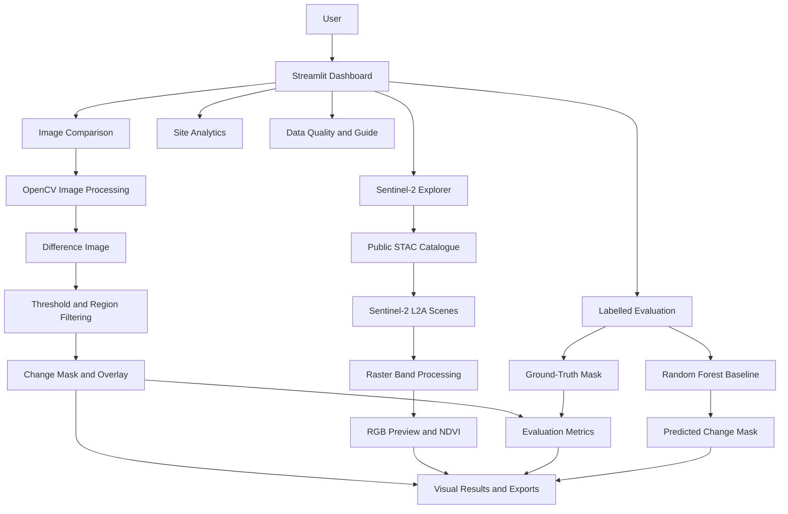
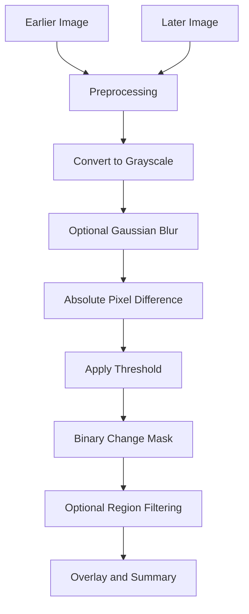
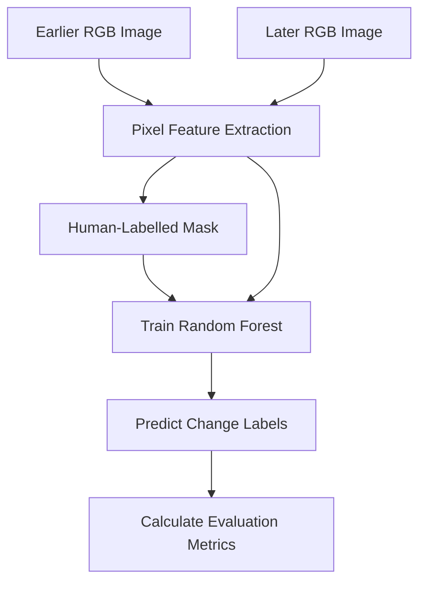

# 🛰️ GeoBuild AI — Satellite-Based Construction Change Monitoring

<p align="center">

  
  
  
  
  

</p>

<p align="center">
  <b>An AI and geospatial analytics portfolio project for exploring visual changes in construction-site imagery.</b>
</p>

<p align="center">
  <a href="https://github.com/yashbankhele/GeoBuild-AI">GitHub Repository</a> •
  <a href="https://planetarycomputer.microsoft.com/">Satellite Data Source</a> •
  <a href="https://docs.streamlit.io/">Streamlit Documentation</a>
</p>

---

## 📌 Table of Contents

- [🌍 Overview](#-overview)
- [🎯 Problem Statement](#-problem-statement)
- [💡 Project Objectives](#-project-objectives)
- [✨ Key Features](#-key-features)
- [🏗️ System Architecture](#️-system-architecture)
- [🛠️ Technology Stack](#️-technology-stack)
- [📂 Project Structure](#-project-structure)
- [⚙️ Installation and Setup](#️-installation-and-setup)
- [🚀 Run the Application](#-run-the-application)
- [🖥️ Application Modules](#️-application-modules)
- [🖼️ Image Change Detection](#️-image-change-detection)
- [🛰️ Sentinel-2 Satellite Explorer](#️-sentinel-2-satellite-explorer)
- [🌱 NDVI Analysis](#-ndvi-analysis)
- [🧪 Model Evaluation](#-model-evaluation)
- [🤖 Random Forest Baseline](#-random-forest-baseline)
- [📊 Data and Outputs](#-data-and-outputs)
- [🧹 Data Quality](#-data-quality)
- [🧪 Testing](#-testing)
- [🔐 Security and Privacy](#-security-and-privacy)
- [⚠️ Limitations](#️-limitations)
- [🗺️ Future Roadmap](#️-future-roadmap)
- [💼 Learning Outcomes](#-learning-outcomes)
- [🤝 Contributing](#-contributing)
- [📄 License](#-license)
- [👨‍💻 Author](#-author)

---

## 🌍 Overview

**GeoBuild AI** is a Python-based geospatial analytics and computer vision portfolio prototype designed to explore construction-site change monitoring using earlier and later images.

The application combines classical image processing, satellite-scene discovery, basic raster analysis, supervised machine-learning experiments, and interactive visualizations in a multi-page Streamlit dashboard.

The project demonstrates how image data and satellite imagery can be processed to identify **potential visual changes** over time.

### 🔎 What does GeoBuild AI do?

1. 🖼️ Compares earlier and later images.
2. 🎨 Generates a binary change mask and a visual overlay.
3. 🛰️ Searches Sentinel-2 L2A satellite scenes through a public STAC catalogue.
4. 🌱 Displays RGB imagery and calculates NDVI from selected spectral bands.
5. 📏 Evaluates predictions against a human-labelled ground-truth mask.
6. 🤖 Provides an optional Random Forest pixel-classification baseline.
7. 📊 Visualizes illustrative site observations and analytics.
8. 📁 Supports selected result exports for further inspection.

> **Transparency:** Built-in sample images and site time-series records are synthetic. The classical image-difference workflow is not a pretrained deep-learning model. Real-world performance has not been established through a validated independent benchmark.

---

## 🎯 Problem Statement

Monitoring changes at construction sites can require repeated site visits, manual inspection, and comparisons of images collected on different dates.

Image processing and satellite data can help analysts identify areas that may have changed and prioritize locations for further inspection.

However, visual differences do not always indicate construction activity. Shadows, clouds, lighting, seasonal variation, camera movement, and image misalignment can also create differences.

GeoBuild AI explores a prototype workflow for investigating these changes while highlighting the importance of data quality and independent validation.

## 💡 Project Objectives

| Objective | Description |
|---|---|
| 🖼️ Image comparison | Compare earlier and later RGB images |
| 🔍 Change detection | Identify pixels with significant visual differences |
| 🗺️ Satellite discovery | Search Sentinel-2 scenes using geographic and temporal filters |
| 🌱 Vegetation analysis | Calculate and visualize NDVI |
| 🧪 Evaluation | Compare predicted changes against human-labelled masks |
| 🤖 Machine learning | Experiment with a Random Forest pixel classifier |
| 📊 Visualization | Present results through an interactive dashboard |
| 📚 Reproducibility | Provide setup instructions, source code, documentation, and tests |

---

## ✨ Key Features

| Feature | Description | Technology |
|---|---|---|
| 📊 Interactive dashboard | Overview of illustrative site records and observations | Streamlit |
| 🖼️ Before/after comparison | Compare two uploaded RGB images | OpenCV, NumPy |
| 🎚️ Adjustable threshold | Control how much pixel difference is required to flag a change | OpenCV |
| 🌫️ Image smoothing | Reduce some small-scale image noise | OpenCV |
| 🧩 Region filtering | Filter small connected changed regions | Computer vision |
| 🔴 Change overlay | Highlight detected differences on the later image | NumPy, OpenCV |
| 🛰️ Satellite search | Discover Sentinel-2 L2A scenes by area and date | STAC, pystac-client |
| 🌈 RGB preview | Display satellite imagery using visible spectral bands | Rasterio, NumPy |
| 🌱 NDVI visualization | Calculate a vegetation index using red and near-infrared bands | Rasterio, NumPy |
| ☁️ Quality screening | Apply a first-pass SCL-based exclusion mask | Sentinel-2 SCL |
| 📏 Evaluation metrics | Calculate Precision, Recall, F1, IoU, and Accuracy | scikit-learn |
| 🤖 ML baseline | Train an optional Random Forest classifier | scikit-learn |
| 📈 Site analytics | Visualize synthetic observations and trends | Streamlit |
| 📤 Result exports | Export supported analysis outputs | Python |
| 🧪 Automated tests | Run basic tests for core image-processing functionality | pytest |

---

## 🏗️ System Architecture

The following diagram shows the high-level workflow.



### 🔄 Main Processing Pipeline

| Stage | Input | Processing | Output |
|---|---|---|---|
| 1. Input | Earlier and later images | Load and validate images | Image arrays |
| 2. Preprocessing | RGB images | Grayscale conversion and optional smoothing | Processed images |
| 3. Difference | Processed images | Calculate absolute pixel differences | Difference image |
| 4. Classification | Difference image | Apply threshold | Binary change mask |
| 5. Refinement | Binary mask | Optional region filtering | Refined mask |
| 6. Visualization | Mask and later image | Create overlay | Visual change map |
| 7. Evaluation | Prediction and reference mask | Calculate metrics | Evaluation report |

---

## 🛠️ Technology Stack

| Technology | Category | Purpose |
|---|---|---|
| 🐍 Python | Programming language | Core application logic |
| 🎈 Streamlit | Web application framework | Interactive dashboard and multi-page interface |
| 👁️ OpenCV | Computer vision | Image conversion, differences, thresholding, and mask operations |
| 🔢 NumPy | Numerical computing | Pixel arrays and numerical calculations |
| 🗺️ Rasterio | Geospatial raster processing | Reading and processing satellite bands |
| 🛰️ pystac-client | Geospatial data discovery | Querying the STAC catalogue |
| 🌐 Planetary Computer | Satellite data platform | Sentinel-2 catalogue and scene assets |
| 🤖 scikit-learn | Machine learning | Evaluation metrics and Random Forest baseline |
| 🧪 pytest | Testing | Automated tests |
| 📄 Pandas | Data analysis | Tabular demo data and related operations |

---

## 📂 Project Structure

```text
GeoBuild-AI/
│
├── app.py
├── requirements.txt
├── README.md
├── generate_sample_images.py
├── .gitignore
│
├── .github/
│   └── workflows/
│       └── tests.yml
│
├── data/
│   ├── demo/
│   │   ├── observations.csv
│   │   └── sites.csv
│   │
│   └── sample_images/
│       ├── before.png
│       └── after.png
│
├── docs/
│   ├── ARCHITECTURE.md
│   └── DATA_PROVENANCE.md
│
├── pages/
│   ├── 1_Image_Comparison.py
│   ├── 2_Sentinel2_Explorer.py
│   ├── 3_Labelled_Evaluation.py
│   ├── 4_Site_Analytics.py
│   └── 5_Data_Quality_and_Guide.py
│
├── src/
│   ├── __init__.py
│   ├── change_detection.py
│   ├── demo_data.py
│   ├── evaluation.py
│   ├── ml_model.py
│   ├── reporting.py
│   └── satellite.py
│
└── tests/
    └── test_change_detection.py
```

### 📁 Important Files

| File | Responsibility |
|---|---|
| `app.py` | Main Streamlit application |
| `src/change_detection.py` | Classical image-difference workflow |
| `src/satellite.py` | Sentinel-2 STAC search and raster-loading functionality |
| `src/evaluation.py` | Change-detection evaluation metrics |
| `src/ml_model.py` | Random Forest pixel-classification baseline |
| `src/demo_data.py` | Demo-data helpers |
| `src/reporting.py` | Reporting and export helpers |
| `generate_sample_images.py` | Generates synthetic sample images |
| `requirements.txt` | Python dependency list |
| `tests/test_change_detection.py` | Tests for image-processing functionality |
| `docs/ARCHITECTURE.md` | Architecture documentation |
| `docs/DATA_PROVENANCE.md` | Data provenance and demo-data documentation |

---

## ⚙️ Installation and Setup

### 📋 Prerequisites

Before running the application, install the following:

| Requirement | Recommendation |
|---|---|
| Operating system | Windows, Linux, or macOS |
| Python | Python 3.11 or 3.12 recommended |
| Git | Required for cloning or version control |
| Internet connection | Required for package installation and satellite catalogue access |
| RAM | Enough to process the selected image sizes and raster bands |

### 1️⃣ Clone the Repository

Open PowerShell or a terminal and run:

```bash
git clone https://github.com/yashbankhele/GeoBuild-AI.git
cd GeoBuild-AI
```

If the repository is already downloaded, open the extracted project directory instead.

### 2️⃣ Create a Virtual Environment

```bash
python -m venv .venv
```

A virtual environment keeps project dependencies separate from other Python projects.

### 3️⃣ Activate the Environment

**Windows PowerShell:**

```powershell
.\.venv\Scripts\Activate.ps1
```

**Windows Command Prompt:**

```cmd
.venv\Scripts\activate.bat
```

**Linux or macOS:**

```bash
source .venv/bin/activate
```

### 4️⃣ Install Dependencies

```bash
python -m pip install --upgrade pip
python -m pip install -r requirements.txt
```

### 5️⃣ Generate Sample Images

```bash
python generate_sample_images.py
```

This script generates the synthetic sample images used for demonstration.

### 6️⃣ Run the Tests

```bash
python -m pytest -q
```

### 7️⃣ Start the Dashboard

```bash
python -m streamlit run app.py
```

Open the following address in your browser if it does not open automatically:

**http://localhost:8501**

---

## 🚀 Run the Application

After installation, follow this workflow:

1. Activate the virtual environment.
2. Start the Streamlit application.
3. Open the dashboard in your browser.
4. Select a page from the sidebar.
5. Upload images or search satellite scenes, depending on the module.
6. Review visual results and evaluation outputs.
7. Export supported results when needed.

> 💡 The Image Comparison page can be used with suitable RGB images. Satellite discovery requires internet access and available scenes in the selected date and geographic range.

---

## 🖥️ Application Modules

### 📊 1. Overview

Provides a starting point for exploring the dashboard and illustrative site observations.

**Purpose:**
- Review synthetic demo site records.
- Explore observation history.
- Understand the intended monitoring workflow.

**Data note:** The built-in site records and time-series data are synthetic examples, not actual construction-site measurements.

### 🖼️ 2. Image Comparison

Compares an earlier image with a later image to highlight potential visual changes.

**Main workflow:**
- Upload two RGB images.
- Adjust image-processing parameters.
- Inspect the difference image.
- Review the binary change mask.
- Inspect the red overlay.
- Export supported outputs.

**Typical use case:** Compare two images of the same construction site taken at different times.

### 🛰️ 3. Sentinel-2 Explorer

Searches for Sentinel-2 Level-2A scenes using a public STAC catalogue.

**Main workflow:**
- Define a geographic bounding box.
- Select a date range.
- Set a maximum cloud-cover filter.
- Search for available scenes.
- Select a scene.
- Preview RGB imagery and NDVI.

**Data source:**

`https://planetarycomputer.microsoft.com/api/stac/v1`

**Collection:** `sentinel-2-l2a`

The current integration is a first-pass explorer. It does not yet implement exact-AOI clipping or complete multi-date image co-registration.

### 📏 4. Labelled Evaluation

Evaluates a predicted change mask against a human-labelled reference mask.

**Required inputs:**

| Input | Description |
|---|---|
| Earlier RGB image | Image from the earlier date |
| Later RGB image | Image from the later date |
| Ground-truth mask | Human-labelled binary reference mask |

All three inputs must refer to the same scene and be aligned to the same dimensions.

**Mask convention:**
- ⚪ White/non-zero pixels: changed
- ⚫ Black/zero pixels: unchanged

The evaluation page reports common classification metrics and provides an optional Random Forest baseline.

### 📈 5. Site Analytics

Visualizes illustrative site observations and trends using the built-in demo dataset.

**Important:** These charts are for demonstrating dashboard functionality. They should not be interpreted as real-world construction progress or performance measurements.

### 🧹 6. Data Quality & Project Guide

Provides guidance on input quality, project limitations, and the intended workflow.

It helps users understand why alignment, cloud contamination, shadows, and label quality matter when interpreting change-detection results.

---

## 🖼️ Image Change Detection

### 🔍 How It Works

The classical change-detection workflow compares corresponding pixels in two images.



### Step 1: Image Preprocessing

Images are loaded and prepared for comparison. Grayscale conversion reduces each RGB pixel to a single intensity value.

Optional smoothing can reduce small-scale noise.

### Step 2: Absolute Difference

For each corresponding pixel, the algorithm calculates:

\[
D(x,y)=|I_1(x,y)-I_2(x,y)|
\]

Where:

- \(I_1\) is the earlier grayscale image.
- \(I_2\) is the later grayscale image.
- \(D\) is the absolute difference image.

### Step 3: Thresholding

A pixel is flagged as changed if its difference exceeds the selected threshold.

\[
M(x,y)=
\begin{cases}
1 & D(x,y)>T\\
0 & D(x,y)\leq T
\end{cases}
\]

Here, \(T\) represents the threshold.

| Parameter | Lower setting | Higher setting |
|---|---|---|
| Threshold | More sensitive; may flag noise | More conservative; may miss subtle changes |
| Blur kernel | Preserves more small details | Smooths more noise but may remove details |
| Minimum region size | Retains smaller regions | Removes smaller regions, potentially including real changes |

### Step 4: Visualization

The binary mask identifies the pixels flagged by the algorithm. The overlay highlights those locations on the later image to make visual inspection easier.

### 📊 Changed-Pixel Share

The application can calculate the share of pixels marked as changed:

\[
\text{Changed Pixel Share}=
\frac{\text{Changed Pixels}}{\text{Total Pixels}}\times100
\]

**Important:** This value is not a construction-completion percentage or a measurement of real-world area. It represents the share of image pixels flagged by the selected algorithm and parameters.

---

## 🛰️ Sentinel-2 Satellite Explorer

### 🌍 Data Discovery

The Sentinel-2 Explorer queries the public Microsoft Planetary Computer STAC catalogue.

STAC stands for **SpatioTemporal Asset Catalog**. It provides a standard way to search geospatial data by properties such as location, time, and metadata.

| Search parameter | Purpose |
|---|---|
| Geographic bounding box | Defines the approximate area to search |
| Start date | Beginning of the date range |
| End date | End of the date range |
| Maximum cloud cover | Filters scenes using catalogue cloud metadata |
| Scene selection | Chooses a matching satellite acquisition |

### 🧪 Sentinel-2 Bands Used

| Band | Spectral region | Role in the application |
|---|---|---|
| B02 | Blue | Blue channel for RGB preview |
| B03 | Green | Green channel for RGB preview |
| B04 | Red | Red channel and NDVI input |
| B08 | Near-infrared | NDVI input |
| SCL | Scene Classification Layer | First-pass pixel-quality exclusion mask |

### ☁️ Cloud and Shadow Screening

The Scene Classification Layer can help identify pixels associated with certain surface and atmospheric conditions.

The current implementation applies a first-pass exclusion mask based on selected SCL classes.

However, catalogue cloud cover and SCL-based screening do not guarantee that every pixel in the selected construction site is cloud-free or valid.

### ⚠️ Current Geospatial Limitations

The current satellite module:
- Searches scenes and reads selected assets.
- Displays RGB and NDVI previews.
- Applies a first-pass quality mask.
- Does not yet clip imagery to the exact requested AOI.
- Does not yet co-register two dates and generate a fully validated satellite change map.

---

## 🌱 NDVI Analysis

NDVI stands for **Normalized Difference Vegetation Index**. It uses red and near-infrared reflectance to estimate vegetation response.

### 📐 Formula

\[
NDVI=\frac{NIR-Red}{NIR+Red}
\]

In this project:

- \(NIR\) corresponds to Sentinel-2 B08.
- \(Red\) corresponds to Sentinel-2 B04.

### 📊 General Interpretation

| NDVI pattern | Possible interpretation | Important caution |
|---|---|---|
| Higher positive values | Vegetation may be present | Interpretation depends on vegetation, season, and conditions |
| Values near zero | Bare soil, built-up surfaces, or mixed pixels may occur | These classes cannot be reliably separated by NDVI alone |
| Negative values | Water, clouds, or other surfaces may produce negative values | Negative values do not identify a unique surface type |

NDVI values typically lie between -1 and +1 when calculated using valid reflectance values and a non-zero denominator.

**NDVI is not a construction-progress metric.** It cannot independently determine whether a building is under construction or how much of a project is complete.

---

## 🧪 Model Evaluation

A change-detection prediction needs a reference answer to assess whether the flagged pixels are correct.

GeoBuild AI supports evaluation using a human-labelled binary ground-truth mask.

### 🏷️ Ground-Truth Mask Requirements

| Requirement | Explanation |
|---|---|
| Same scene | The mask must correspond to the exact earlier/later image pair |
| Same dimensions | Height and width must match the input images |
| Correct alignment | Pixels must refer to corresponding locations |
| Binary labels | White/non-zero means change; black/zero means unchanged |
| Consistent annotation rules | The definition of a change must be applied consistently |

For example, if a project defines new building footprints and visible earthwork as change, the reference mask should follow that definition consistently.

### 📐 Evaluation Metrics

Let:

- **TP:** True Positive — actual change correctly predicted.
- **FP:** False Positive — unchanged pixel incorrectly predicted as changed.
- **FN:** False Negative — actual change missed by the prediction.
- **TN:** True Negative — unchanged pixel correctly predicted as unchanged.

| Metric | Formula | Meaning |
|---|---|---|
| Precision | TP / (TP + FP) | Of the predicted changes, how many were correct? |
| Recall | TP / (TP + FN) | Of all actual changes, how many were detected? |
| F1-score | 2 × Precision × Recall / (Precision + Recall) | Balance between precision and recall |
| Intersection over Union (IoU) | TP / (TP + FP + FN) | Overlap between predicted and reference change regions |
| Accuracy | (TP + TN) / (TP + TN + FP + FN) | Share of all pixels classified correctly |

Implementations may define a convention for cases where a denominator is zero.

### ⚠️ Why Accuracy Alone Is Not Enough

In a large image, unchanged background pixels may vastly outnumber changed pixels. A system that predicts almost everything as unchanged could still achieve high accuracy while missing important changes.

For that reason, Precision, Recall, F1-score, and IoU should also be examined.

### 🧑‍🔬 Recommended Evaluation Protocol

For credible results:

1. Collect image pairs from multiple independent sites and dates.
2. Define annotation rules before labelling.
3. Create human-labelled masks.
4. Separate training and testing data by site or date.
5. Keep an untouched test set.
6. Report all relevant metrics and representative failure cases.
7. Document data sources and preprocessing steps.

No validated real-world accuracy claim is included in this repository.

---

## 🤖 Random Forest Baseline

GeoBuild AI includes an optional supervised Random Forest pixel-classification baseline.

A Random Forest combines multiple decision trees to produce a prediction.

### 🔄 Workflow



The implementation uses image-pair pixel features and labels from the ground-truth mask to learn changed versus unchanged classifications.

### ⚠️ Important Model Limitation

The current implementation uses a random pixel split as a development smoke test. Nearby pixels can be highly correlated, which may cause test results to look more optimistic than performance on a new site.

This baseline should not be presented as a robust generalization benchmark. Site-held-out or date-held-out evaluation is needed before making stronger performance claims.

**This project does not ship with a validated pretrained deep-learning change-detection model.**

---

## 📊 Data and Outputs

### 📁 Data Provenance

| Data | Source | Intended use |
|---|---|---|
| Sample `before.png` and `after.png` | Synthetic image generator | Demonstrate the image-comparison workflow |
| `sites.csv` | Synthetic demo data | Illustrative site records |
| `observations.csv` | Synthetic demo data | Illustrative time-series analytics |
| User-uploaded RGB images | User-provided | Image comparison and evaluation |
| Human-labelled mask | User-provided | Evaluation reference |
| Sentinel-2 scenes | Public Microsoft Planetary Computer catalogue | Satellite exploration and raster preview |

### 📤 Supported Output Types

Depending on the selected page and available controls, the application supports outputs such as:

| Output | Purpose |
|---|---|
| Change mask | Inspect pixels flagged as changed |
| Red overlay | Visually review predicted changes |
| Difference image | Inspect pixel-level differences |
| CSV report | Export supported tabular results |
| Markdown report | Save supported textual results |
| Evaluation metrics | Review prediction performance against labels |

The exact outputs available depend on the selected workflow.

---

## 🧹 Data Quality

Good input data are essential for meaningful change detection.

| Quality issue | Potential effect | Recommended action |
|---|---|---|
| Image misalignment | Stable structures may appear changed | Check and correct alignment |
| Different camera angles | Large areas may show false changes | Use comparable viewpoints or registration |
| Shadows | False-positive regions | Inspect lighting and shadow changes |
| Clouds and haze | Missing or misleading surface information | Apply suitable quality screening |
| Seasonal differences | Vegetation changes may dominate | Compare suitable dates and interpret seasonality |
| Different resolutions | Pixel differences may be misleading | Check resolution and preprocessing |
| Poor ground-truth labels | Evaluation scores become unreliable | Use consistent annotation rules |
| Spatial leakage | Test scores may be overly optimistic | Split by site or date |

### ✅ Recommended Checklist

- [ ] Verify that images show the same site.
- [ ] Check dates, dimensions, resolution, and alignment.
- [ ] Inspect cloud, shadow, and illumination differences.
- [ ] Use a correctly aligned ground-truth mask for evaluation.
- [ ] Review false positives and false negatives.
- [ ] Test on independent sites or dates before reporting generalization.

---

## 🧪 Testing

Run the automated tests from the project root:

```bash
python -m pytest -q
```

The repository includes tests for core change-detection functionality.

Tests help identify implementation regressions, but passing tests do not prove that the application is accurate on real construction sites.

For further validation, test with labelled image pairs from multiple independent locations and dates.

---

## 🔐 Security and Privacy

- 🔑 Do not commit passwords, access tokens, API keys, or private credentials.
- 🚫 Keep `.env` files and virtual environments out of version control.
- 🗂️ Check uploaded files before publishing them in a public repository.
- 🛰️ Review the applicable data-source terms before redistributing satellite imagery.
- 📋 Do not upload confidential site images or sensitive project data to a public repository.

---

## ⚠️ Limitations

GeoBuild AI V3 is a **portfolio and learning prototype**, not a production-ready construction-monitoring service.

| Limitation | Current status |
|---|---|
| Synthetic demo data | Built-in sample imagery and site time series are illustrative |
| Classical change detection | Pixel differences can flag non-construction changes |
| Geographic registration | Image resizing alone does not align real-world locations |
| Satellite AOI clipping | Exact requested-area clipping is not yet implemented |
| Multi-date satellite processing | Full co-registration and satellite-to-satellite change mapping are not yet implemented |
| Cloud and shadow handling | First-pass screening does not remove every source of contamination |
| NDVI interpretation | NDVI measures vegetation response, not construction completion |
| Area estimation | Flagged pixel share is not a validated real-world area measurement |
| Model generalization | Random pixel splitting does not provide a robust site-level benchmark |
| Validated accuracy | No validated real-world performance claim is provided |

---

## 🗺️ Future Roadmap

Planned improvements include:

- [ ] 🗺️ Exact AOI clipping and geospatial area calculations.
- [ ] 🧭 Improved image alignment and multi-date co-registration.
- [ ] ☁️ Stronger cloud and shadow quality screening.
- [ ] 🏷️ Human-labelled masks from multiple independent sites.
- [ ] 🧪 Site-held-out and date-held-out model evaluation.
- [ ] 🤖 Comparison with suitable change-detection or segmentation networks.
- [ ] 📊 More comprehensive evaluation reports and failure analysis.
- [ ] 📸 Application screenshots and a demonstration video.
- [ ] 🚀 Deployment and reproducibility improvements.

---

## 💼 Learning Outcomes

This project demonstrates practical exploration of:

- Python application development.
- Streamlit dashboard development.
- Computer vision and image processing.
- Raster and satellite-data handling.
- STAC-based geospatial data discovery.
- NDVI calculation and visualization.
- Supervised pixel classification.
- Model evaluation and confusion-matrix interpretation.
- Data-quality assessment.
- Git, GitHub, automated testing, and project documentation.

It also illustrates why reliable real-world AI requires suitable data, careful validation, and honest reporting of limitations.

---

## 🤝 Contributing

Suggestions, bug reports, and improvements are welcome.

A simple contribution workflow:

1. Fork the repository.
2. Create a feature branch.
3. Make and test your changes.
4. Submit a pull request describing the change.

Please avoid submitting private data, credentials, or unverified performance claims.

---

## 📄 License

No license has been specified for this repository yet.

Before allowing redistribution or external contributions, choose an appropriate open-source license and add its license file to the repository.

Until a license is added, do not assume that the project is licensed for unrestricted reuse.

---

## 👨‍💻 Author

**Yash Bankhele**

🎓 Artificial Intelligence & Data Science

🔗 **GitHub:** [github.com/yashbankhele](https://github.com/yashbankhele)

📌 **Project Repository:** [GeoBuild AI](https://github.com/yashbankhele/GeoBuild-AI)

---

<p align="center">
  <b>🛰️ GeoBuild AI — Exploring Visual Change Detection with Computer Vision and Satellite Data</b>
</p>

<p align="center">
  <i>Built for learning, experimentation, and transparent technical demonstration.</i>
</p>
